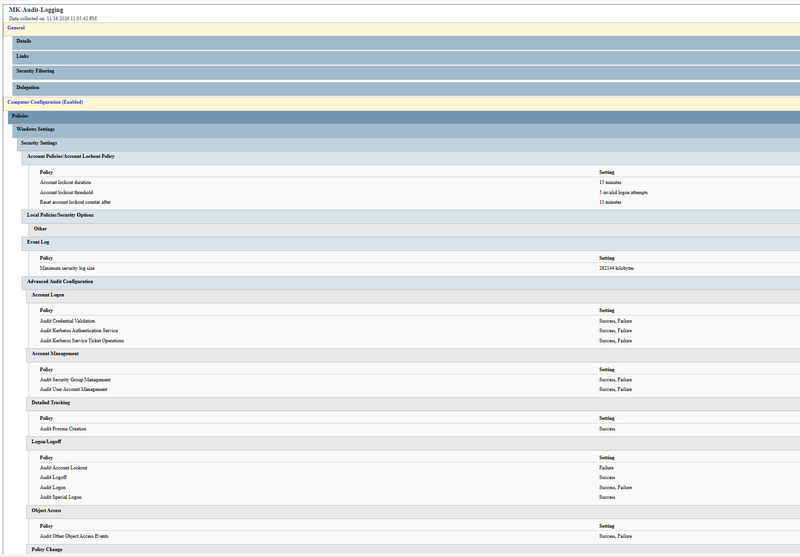

# Sprint 1: Windows Domain and Active Directory

*Mainkai Logistik home SOC lab · 9–26 November 2026*

## Goal

<!-- 2–3 sentences: what this sprint was meant to achieve and why it matters for a SOC -->

## What I built

<!-- Short description of the lab, then the diagram -->

| Machine | Role | OS |
| --- | --- | --- |
| DC01 | Domain controller (AD, DNS) | Windows Server 2022 |
| WS01 | Employee workstation | Windows 11 Enterprise |

## Logging setup

### Group Policy: MK-Audit-Logging

| Setting | Why it matters | Event IDs it enables |
| --- | --- | --- |
| Audit Process Creation + command line | See every program started, and how | 4688 |
| Audit Logon (Success, Failure) | Who logged on where, and failed attempts | 4624, 4625 |
| Kerberos Authentication / Service Ticket | Domain logons and service access | 4768, 4769 |
| User Account / Security Group Management | Account creation, group changes (e.g. Domain Admins) | 4720, 4728, 4732 |
| PowerShell Script Block Logging | Records the actual PowerShell code run | 4104 |
| Security log size 256 MB | Keeps evidence longer before overwriting | — |

Full report: [mk-audit-logging.html](../docs/mk-audit-logging.html)

### Sysmon

<!-- Which config (sysmon-modular), on which machines, and what Sysmon adds compared to the Security log -->

## Five things I learned

1. 
2. 
3. 
4. 
5. 

## First hunt: MK-1

<!-- 3–4 sentences: the alert, what you found, the verdict -->

Full ticket: [MK-001](../tickets/MK-001.md)

## Problems and fixes

| Problem | Cause | Fix |
| --- | --- | --- |
|  |  |  |

## Next sprint

<!-- 1–2 sentences on Sprint 2: Elastic SIEM -->